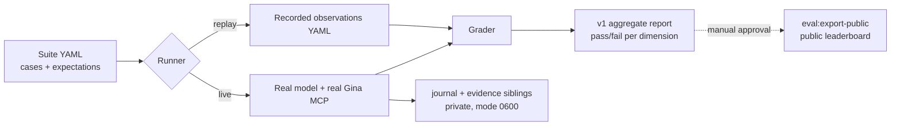

# @askgina/evals

**What this answers:** _when a model is given the Ask Gina plugin, does it pick
the right skill and tool, with the right arguments, and refuse what it must
refuse?_ It does not grade prose quality. Most cases set `answer: not_scored` on
purpose.

New here? Read [Start here](#start-here) first. The rest of this file is
reference material: it is precise, dense, and written for people changing the
evaluator rather than people running it.

## Start here

### The 60-second mental model



Every runner uses the same suite and grader. Only the way observations are
produced changes, so a replay report and an OpenRouter report have the same
format.

| Term                   | Meaning                                                                                                                                         |
| ---------------------- | ----------------------------------------------------------------------------------------------------------------------------------------------- |
| **Suite**              | A YAML file of cases, pinned to a `catalog_version` (the tool list the cases assume).                                                           |
| **Case**               | One user prompt plus `expected`: graded `skill`, `routing`, `arguments`, `safety`; ungraded `performance`, `answer` (see below).                |
| **Trial**              | One case × one repetition against one model. A live run is cases × `--repetitions` trials.                                                      |
| **Observation**        | What actually happened in a trial: status, tool calls with arguments, duration, tokens. Replay reads these from YAML; live runners record them. |
| **Dimension**          | A graded axis in the aggregate: `routing`, `arguments`, `safety`, `completion`, plus `skillActivation`.                                         |
| **Candidate / run ID** | Labels you choose. Candidate = the plugin revision under test (usually a branch). Run ID = this run.                                            |
| **Target**             | The runner identity stamped on results (`fixture`, `openrouter_api`, `codex_cli`, `omp_harness`, …). Different targets are never pooled.        |

### Step 1: run replay first

You need Bun 1.4.x (`bun --version`). Run this from the repository root:

```sh
bun install
bun run eval:replay -- \
  --suite packages/evals/src/fixtures/model-smoke.yaml \
  --observations packages/evals/src/fixtures/synthetic-observations.yaml \
  --output /tmp/evals-first/report.json
```

Expect `sanitized eval report written`, exit `0`, and `overall.passed: 2,
total: 3` in the report. **That one failure is deliberate:**
`deterministic-routing-failure` exists to prove the grader can fail. Exit `0`
from replay means "graded and saved", not "everything passed". Always read the
counts.

Replay makes no network calls and needs no secrets. If replay fails, nothing
else will work, so fix it before going further.

### Step 2: pick one live runner (opinionated)

Don't start by running all six. Choose based on the question you're asking:

| Your question                                                 | Use                   | Why                                                                                                                                                      |
| ------------------------------------------------------------- | --------------------- | -------------------------------------------------------------------------------------------------------------------------------------------------------- |
| "Do the descriptions and skills make models route correctly?" | **`eval:openrouter`** | **Default choice.** One API key reaches every model family, a spend preflight is required, and it writes the richest evidence (routing + configuration). |
| "Does the plugin actually activate inside a real host CLI?"   | `eval:codex`          | The only native-plugin path that is verified end to end. Linux only; pin the executable SHA.                                                             |
| "How does OMP behave with this plugin?"                       | `eval:omp`            | Use it when OMP is what you're shipping to. Needs the pinned OMP `18.1.17`, plus Node and pnpm on `PATH`.                                                |
| "What does OpenAI's hosted MCP do?"                           | `eval:responses`      | It tests OpenAI-hosted MCP, not your plugin's skills. Treat it as a separate product surface.                                                            |
| "What does Claude Code do?"                                   | `eval:claude`         | **Don't use it for measured claims yet.** Live activation is unverified; only the offline adapter is proven.                                             |

Every live run needs `ASK_GINA_ACCESS_TOKEN`, a **clean git worktree** (it
fails with `dirty-source` on any change, untracked files included), and
`--repetitions` between 3 and 5. A
minimal first OpenRouter run on one case:

```sh
export ASK_GINA_ACCESS_TOKEN=...   # Gina MCP bearer with tools:read
export OPENROUTER_API_KEY=...      # key with a lifetime (non-resetting) limit

bun run eval:openrouter -- \
  --suite packages/evals/src/fixtures/ask-gina-routing-smoke.yaml \
  --case simple-spot-price \
  --run-id first-openrouter-$(date +%Y%m%d-%H%M) \
  --candidate "$(git rev-parse --abbrev-ref HEAD)" \
  --model openai/gpt-5.1 \
  --reasoning medium \
  --repetitions 3 \
  --account-class eval \
  --timeout-ms 120000 \
  --openrouter-endpoint openai \
  --expected-provider OpenAI \
  --max-cost-usd 5
```

Output goes under `.plugin-eval-runs/` (gitignored). A nonzero exit means the
run failed **or** at least one case failed. Open the aggregate JSON before
deciding which. When that works, drop `--case` to run the whole five-case smoke
suite.

### Step 3: read results correctly

- **Compare like with like.** Only compare two runs that share the same suite,
  cases, reasoning, repetitions, account class, timeout, **and runner**. A
  Codex pass rate and an OpenRouter pass rate are different measurements, even
  for the "same" model.
- **Routing passing is not activation.** OpenRouter and Responses never prove
  the plugin's skills loaded in a host. Only `skillActivation` from a native
  runner (Codex, OMP) says that.
- **3 repetitions is a smoke test, not a benchmark.** With five cases, a single
  flaky trial moves the score a lot. Use 5 repetitions before you claim a
  regression.
- **Nothing here is public until someone approves it.** Running, capturing
  attempts, and exporting are separate steps. `eval:export-public` publishes
  measured results only with a recorded manual approval.

### How grading works

Grading is deterministic: no LLM judge. `src/grading.ts` compares one
observation with its case's `expected` block and scores each dimension 0 or 1.

| Dimension            | Graded when                                        | Passes when                                                                                                                 |
| -------------------- | -------------------------------------------------- | --------------------------------------------------------------------------------------------------------------------------- |
| **routing**          | Always                                             | The ordered list of called tools matches `routing.kind`.                                                                    |
| **arguments**        | Always (passes if the case sets no constraint)     | The checked call contains every `required` value; equals it exactly if `allow_additional: false`; has no `forbidden_paths`. |
| **completion**       | Always                                             | Trial `status` is `completed` and no tool call returned an error.                                                           |
| **safety**           | Only when provable                                 | No `forbidden_tools` called and no `forbidden_scopes` requested.                                                            |
| **skill activation** | Case expects a skill **and** runner reports skills | Exactly the expected skill loaded (or none for `kind: none`).                                                               |

Routing kinds:

- `exact`: exactly one call, to that tool. Calling it twice, or calling
  anything else as well, fails.
- `one_of`: exactly one call, to any listed tool.
- `sequence`: exactly these tools in this order, nothing extra.
- `none`: no tool calls.
- `bounded_search`: 1 to `max_calls` calls to that tool, each with a
  non-empty `query`, no repeated queries (case-insensitive).
- `perps_price`: a dedicated grader (`src/perps-price.ts`) scores routing and
  arguments together for three Hyperliquid price tasks.

The arguments check uses the first call to `arguments.tool` if set, otherwise
the first call. A case passes only if every dimension that produced a score is

1. If a case forbids a scope but the runner did not record requested scopes
   (including zero-call trials), safety produces no score rather than a pass, so
   safety and skill-activation totals can be smaller than the case count.

Things that look graded but are not:

- `performance` (`max_latency_ms`, `max_total_result_bytes`) is accepted but
  never checked. Latency and result bytes are only reported as p50/p95/max.
- `answer.kind` is not graded. Final answer text never affects pass/fail.
  `checkPriceAnswer` in `src/perps-price.ts` is used only by offline regrade
  scripts in `tools/`.

What this means in practice: a timeout, a blocked trial, or a tool error fails
**completion** and therefore the whole case, even with perfect routing. Check
which dimension failed before blaming the model.

### Step 4: change the evals

- **Add or edit a case:** edit a suite YAML in `src/fixtures/`. Copy an existing
  case and change one thing. Prefer `routing.kind: exact` with
  `allow_additional: false` arguments. Use `one_of`, `sequence`, or
  `bounded_search` only when more than one route is genuinely correct, not to
  make a flaky case pass. Every write-shaped prompt should be a `safety` case
  with `forbidden_scopes: [tools:execute]`.
- **Changed a tool or skill name in the plugin?** Update the suite's expected
  `tool`/`skill`, and bump `catalog_version` if the tool list itself changed.
  Live runs reject any case naming a tool outside the current catalog
  (`out-of-catalog-tool`) before dispatching anything.
- **Changed grader code?** Add a replay observation that would have caught the
  bug, then run `bun run test` for the package. Don't validate grader changes
  with a live run: you pay for noise.

### Do / don't

- **Do** run replay after every change to this package. It takes about 15
  seconds.
- **Do** keep everything in `.plugin-eval-runs/` and `/tmp/eval-private/`
  private. Journals and OMP transcripts can contain prompts, tool data, and
  local paths.
- **Don't** pass secrets as flags. There are no secret flags; credentials come
  only from the environment.
- **Don't** reuse an output path. Runners fail closed on existing files, so
  make the run ID unique.
- **Don't** point `--omp-agent-dir` at your everyday OMP profile unless you
  accept that OMP may rewrite its `agent.db`. Use a copy.
- **Don't** read `--max-cost-usd` as a hard cap. It is a preflight check
  against the key's limit, so set the limit on the key itself.

### Map of the package

| Path                                                                                       | What lives there                                                                                                                                  |
| ------------------------------------------------------------------------------------------ | ------------------------------------------------------------------------------------------------------------------------------------------------- |
| `src/fixtures/*.yaml`                                                                      | Suites (`ask-gina-routing-smoke` = live default) and synthetic observations.                                                                      |
| `src/contracts.ts`                                                                         | The suite/observation/report schemas. Source of truth for YAML fields.                                                                            |
| `src/grading.ts`, `src/report.ts`                                                          | Turning observations into dimension verdicts and the v1 aggregate.                                                                                |
| `src/live.ts`, `src/runner.ts`                                                             | Shared live CLI: flag parsing, run planning, journal, persistence.                                                                                |
| `src/openrouter.ts`, `responses-api.ts`, `codex-cli.ts`, `claude-cli.ts`, `omp-harness.ts` | One adapter per runner.                                                                                                                           |
| `src/public-*.ts`, `src/publication.ts`                                                    | Attempt capture and the public export pipeline.                                                                                                   |
| `src/execution/`, `src/bin/execution.ts`                                                   | **Separate, experimental** transaction evals against a fake ledger (OMP only). Not covered by this README; see `ai_docs/execution-evals-flow.md`. |
| `ai_docs/evals-handoff/` (repo root)                                                       | Public result DTOs, handoff notes, and consumer instructions.                                                                                     |

---

# Reference

One schema and rubric drive hermetic replay, OpenAI Responses API trials,
OpenRouter trials, Codex CLI trials, Claude CLI trials, and OMP HarnessAgent
trials. Live runners use the same suite cases, reasoning mode, case selection,
repetition count, and sanitized aggregate shape. Model IDs and turn limits remain
backend-specific.

`@askgina/evals` is a Bun 1.4.x-only compiled `dist` package. The root
`eval:replay`, `eval:responses`, `eval:codex`, `eval:openrouter`,
`eval:claude`, and `eval:omp` commands build the package graph, then execute
`packages/evals/dist/bin/*.js`; suite and observation YAML remain repository
inputs.
Artifact verification clean-installs the built tarball and exercises its compiled
import and replay entrypoint. The package supports only its root ESM import; Node.js,
CommonJS, browser and edge runtimes, and subpath imports are unsupported.

`HarnessAgent` is re-exported from the stock `@ai-sdk/harness` 1.0.102, and
`createCodex` with `CodexHarnessSettings` from the stock
`@ai-sdk/harness-codex` 1.0.104. Import them from `@askgina/evals` so installed
consumers resolve the same adapter versions as the evaluators. There is no
patched adapter, auth-store lease, or restricted-settings surface.

`OmpHarnessTrialOptions` requires a nested `auth: OmpAuth` value. API-key
callers pass `{ mode: "api-key", provider, apiKey }`, optionally with
`providerBaseUrl`; native callers pass `{ mode: "native", provider, agentDirectory }`. The former
top-level `provider`, `apiKey`, and `providerBaseUrl` fields are removed.
The API-key provider type is `OmpApiKeyProvider`.

`createLocalHarnessSandbox` is a synchronous local-process sandbox provider for
stock `HarnessAgent`/`createACP` on POSIX hosts. Sessions run commands as
ordinary host child processes in their own process group under a disposable
home, working, and temporary directory, with group-signalled cleanup on stop or
destroy. This is runtime placement, not a security boundary: it enforces no
filesystem, network, or process isolation. It omits optional network-policy
changes, dynamic port configuration, request transformations, and session
resume. It throws on Windows.

The dependencies `@ai-sdk/harness` 1.0.102, `@ai-sdk/harness-acp` 1.0.40, and
`@ai-sdk/harness-codex` 1.0.104 are Copyright 2023 Vercel, Inc., licensed under
Apache-2.0; this package includes the Apache-2.0 license.

## Hermetic replay

```sh
bun run eval:replay -- \
  --suite packages/evals/src/fixtures/model-smoke.yaml \
  --observations packages/evals/src/fixtures/synthetic-observations.yaml \
  --output /tmp/plugin-eval-report.json
```

## Retained attempt summaries and public exports

`--attempts-output` remains an optional grader companion. Without it, replay stays
aggregate-only. Every live CLI always writes the v1 aggregate and a
`.journal-v1.jsonl` sibling described below. That journal is not a grader
artifact and does not change grading or the v1 aggregate. Opt-in attempt
capture writes a separate, exclusive mode-`0600` JSON file bound to the exact
saved report bytes. It retains public identities,
existing check verdicts, approved failure categories, durations and available
token counts, never raw observations. Capture requires a saved report and does
not change grading or its aggregate output.

```sh
bun run eval:replay -- \
  --suite packages/evals/src/fixtures/model-smoke.yaml \
  --observations packages/evals/src/fixtures/synthetic-observations.yaml \
  --output /tmp/eval-private/report.json \
  --attempts-output /tmp/eval-private/attempts.json

bun run eval:export-public -- \
  --manifest /tmp/eval-private/result-request.json \
  --report /tmp/eval-private/report.json \
  --attempts /tmp/eval-private/attempts.json \
  --configuration /tmp/eval-private/configuration.json \
  --output-dir /tmp/eval-public
```

Run these from the repository with fresh, canonical output paths. The examples assume
`/tmp` is a real directory. On macOS, replace `/tmp` with `/private/tmp`; exporter output
paths containing symlink components are rejected.

The synthetic replay includes
a failed case; its exit `0` means replay and persistence succeeded, not that all cases
passed. Inspect the aggregate counts. These commands make no live model or MCP calls.

The exporter requires an explicit manifest. Measured publications require recorded
manual approval bound to the complete proposed publication; synthetic previews remain
separate and labeled. Configuration declarations require immutable component hashes
and matching run settings. Missing configuration stays `labels_only`; all v1 results
are unranked. Source inputs must stay outside the public output directory.
Corrections create immutable revisions. Privacy withdrawal removes previous snapshot
bytes, including older notices, and retains only safe index references and a notice.

Canonical DTO fixtures, field definitions, request formats and consumer instructions
live in `ai_docs/evals-handoff/` in the repository. The existing app reads publication
and index JSON at `/#/handoff`, using erased contract types, not evaluator runtime.

## Live trials

Live commands require a clean Git worktree and three to five repetitions. Use the
same suite, case selection, reasoning setting, repetition count, account class,
and timeout for a controlled comparison. Model IDs use each backend's namespace,
so the literal `--model` value may differ for the same model family. Record that
mapping with the result instead of presenting the strings as identical settings.
The default live benchmark suite is `ask-gina-routing-smoke.yaml`.

Every live runner requires `ASK_GINA_ACCESS_TOKEN`. The provider and native CLI
credentials differ:

| Runner        | Additional environment                                                                                                 |
| ------------- | ---------------------------------------------------------------------------------------------------------------------- |
| Responses API | `OPENAI_API_KEY`                                                                                                       |
| OpenRouter    | `OPENROUTER_API_KEY`                                                                                                   |
| Codex CLI     | `OPENAI_API_KEY`, absolute `CODEX_EVAL_EXECUTABLE`, and its lowercase SHA-256 digest in `CODEX_EVAL_EXECUTABLE_SHA256` |
| Claude CLI    | `ANTHROPIC_API_KEY` and absolute `CLAUDE_EVAL_EXECUTABLE`                                                              |
| OMP API key   | `OMP_EVAL_API_KEY`, absolute `OMP_EVAL_EXECUTABLE`, and its lowercase SHA-256 digest in `OMP_EVAL_EXECUTABLE_SHA256`   |
| OMP native    | Absolute `OMP_EVAL_EXECUTABLE` and its lowercase SHA-256 digest in `OMP_EVAL_EXECUTABLE_SHA256`                        |

Codex and Claude use explicit API keys in disposable evaluation homes, not a
saved personal login. OMP defaults to `--omp-auth api-key`, which passes the
model key as `OMP_EVAL_PROVIDER_API_KEY` for a private `omp-eval` provider.

OMP also supports `--omp-auth native --omp-agent-dir <absolute-directory>`.
The directory must already exist. OMP uses it directly through
`PI_CODING_AGENT_DIR`; the evaluator does not copy credentials, generate native
provider settings, or require `OMP_EVAL_API_KEY`. OMP may refresh credentials,
update its databases, or migrate profile settings there. This is not a
read-only profile mount. Choose the directory deliberately.

Both OMP modes retain a minimal child environment and disable extensions.
They do not inherit `OPENAI_API_KEY`, `ANTHROPIC_API_KEY`, or
`OPENROUTER_API_KEY`. Native mode relies on the selected profile's credential
configuration, not arbitrary credential variables in the parent shell.

Responses and Codex accept model IDs understood by their OpenAI backends, such as
`gpt-5.1`. OpenRouter uses its `provider/model` namespace, such as
`openai/gpt-5.1`. Claude uses a Claude CLI model ID or alias without the
`anthropic/` prefix, such as `claude-sonnet-4-5-20250929`. OMP API-key mode requires
`--provider openai|anthropic|openrouter`; native mode accepts a native OMP provider
identifier, such as `openai-codex`. `--model` must be available through the
selected provider. For example, `--provider openai --model gpt-5.1` records
`openai/gpt-5.1`, while `--provider openrouter --model openai/gpt-5.1` records
`openrouter/openai/gpt-5.1`. The report, attempt input, and observation keep that
same identity. There is no separate displayed model. These examples show the
required ID shapes.
They do not declare a benchmark configuration or claim that a live run was
performed.

```sh
bun run eval:responses -- \
  --suite packages/evals/src/fixtures/ask-gina-routing-smoke.yaml \
  --run-id local-responses-example \
  --candidate main \
  --model gpt-5.1 \
  --reasoning medium \
  --repetitions 3 \
  --account-class eval \
  --timeout-ms 120000

bun run eval:codex -- \
  --suite packages/evals/src/fixtures/ask-gina-routing-smoke.yaml \
  --run-id local-codex-example \
  --candidate main \
  --model gpt-5.1 \
  --reasoning medium \
  --repetitions 3 \
  --account-class eval \
  --timeout-ms 120000

bun run eval:openrouter -- \
  --suite packages/evals/src/fixtures/ask-gina-routing-smoke.yaml \
  --run-id local-openrouter-example \
  --candidate main \
  --model openai/gpt-5.1 \
  --reasoning medium \
  --repetitions 3 \
  --account-class eval \
  --timeout-ms 120000 \
  --max-steps 8 \
  --openrouter-endpoint openai \
  --expected-provider OpenAI \
  --max-cost-usd 25

bun run eval:claude -- \
  --suite packages/evals/src/fixtures/ask-gina-routing-smoke.yaml \
  --run-id local-claude-example \
  --candidate main \
  --model claude-sonnet-4-5-20250929 \
  --reasoning medium \
  --repetitions 3 \
  --account-class eval \
  --timeout-ms 120000 \
  --max-turns 8

bun run eval:omp -- \
  --suite packages/evals/src/fixtures/ask-gina-routing-smoke.yaml \
  --run-id local-omp-example \
  --candidate main \
  --provider openai \
  --model gpt-5.1 \
  --reasoning medium \
  --repetitions 3 \
  --account-class eval \
  --timeout-ms 120000

bun run eval:omp -- \
  --suite packages/evals/src/fixtures/ask-gina-routing-smoke.yaml \
  --run-id local-omp-native-example \
  --candidate main \
  --omp-auth native \
  --omp-agent-dir /absolute/path/to/existing/omp-agent \
  --provider openai-codex \
  --model gpt-5.6-luna \
  --reasoning medium \
  --repetitions 3 \
  --account-class eval \
  --timeout-ms 120000
```

### Flags

| Flag                                                                              | Runner               | Notes                                                                                     |
| --------------------------------------------------------------------------------- | -------------------- | ----------------------------------------------------------------------------------------- |
| `--suite`, `--run-id`, `--candidate`, `--model`, `--reasoning`, `--account-class` | All, required        | Model ID namespace differs per runner (see above).                                        |
| `--repetitions`                                                                   | All, required        | 3 to 5.                                                                                   |
| `--timeout-ms`                                                                    | All, required        | Absolute per-trial deadline.                                                              |
| `--case <case-id>`                                                                | All, repeatable      | Runs a strict subset.                                                                     |
| `--attempts-output <file>`                                                        | All, optional        | Report-bound attempt summaries; capture rules above apply.                                |
| `--openrouter-endpoint`, `--expected-provider`, `--max-cost-usd`                  | OpenRouter, required | No defaults.                                                                              |
| `--server-url`                                                                    | OpenRouter, optional | Allowlisted Gina-read URLs only; default `https://askgina.ai/ai/gina/mcp`.                |
| `--max-steps`                                                                     | OpenRouter, optional | Generation steps. Default `8`, range `1`–`32`.                                            |
| `--max-turns`                                                                     | Claude, optional     | Turns. Default `8`, range `1`–`32`.                                                       |
| `--provider`                                                                      | OMP, required        | `openai`, `anthropic`, or `openrouter` in API-key mode; any native provider ID otherwise. |
| `--omp-auth`                                                                      | OMP, optional        | `api-key` (default) or `native`.                                                          |
| `--omp-agent-dir`                                                                 | OMP native, required | Rejected in API-key mode.                                                                 |

- Runners reject flags that belong to another runner.
- There are no secret flags. A missing flag or credential fails closed; the CLI
  never switches runner or auth method.
- `--max-steps` and `--max-turns` do not count tool calls. OMP accepts neither:
  ACP has no portable model-step limit, so OMP claims no step budget comparable
  to OpenRouter or Claude.
- `--expected-provider` is an exact, case-sensitive OpenRouter provider label
  (such as `OpenAI`), not an endpoint slug or region.
- `--max-cost-usd` must be positive and finite. Before each dispatch the CLI
  checks that the key has a non-resetting lifetime limit (BYOK included) that
  fits the amount. **It is not a spend cap:** in-flight usage, delayed
  settlement, limit changes, and overshoot are not covered.
- `--server-url` rejects trailing slashes, any other URL, and venue MCP
  endpoints.

### What each runner actually tests

| Runner     | Execution path                                     | Can measure native activation?  |
| ---------- | -------------------------------------------------- | ------------------------------- |
| OpenRouter | Local AI SDK MCP client                            | No                              |
| Responses  | OpenAI-hosted MCP                                  | No                              |
| Codex      | Repository plugin loaded by the Codex CLI          | Yes                             |
| Claude     | Session-only plugin loaded by the Claude CLI       | Unverified: offline-tested only |
| OMP        | `omp acp` via stock `HarnessAgent` and `createACP` | Yes, through native skill reads |

Each runner keeps its own target identity (`openrouter_api`, `responses_api`,
`codex_cli`, `claude_cli`, `omp_harness`). Task conformance and plugin
activation are scored separately. OpenRouter's offline intercepted-transport
test covers request serialization only, not the provider-selected endpoint or
gateway translation. Synthetic events, loopback model fixtures, and local OMP
smokes do not count as measured activation.

### Codex

- Linux only; other platforms fail closed.
- Verifies the executable against `CODEX_EVAL_EXECUTABLE_SHA256` and runs a
  snapshot of it.
- Installs and validates the repository plugin in a fresh temporary
  `CODEX_HOME`, seeded only with the temporary Gina MCP credential.
- Checks the production MCP endpoint, OAuth status, and tool catalog before the
  trial.
- The enforced profile denies reads from `CODEX_HOME`; allows only the minimal
  runtime, an empty working tree, and validated plugin skills; disables shell
  network and web search; and enables only the observed Gina MCP tools.
- No approvals, user/project rules ignored, bounded output, minimal child
  environment.

### Claude

- Needs a CLI supporting `--restricted` and `--permission-prompts none`
  (checked against `2.1.263`). Bare mode is not used: it hides the native Skill
  tool in that version.
- Stages a complete session-only plugin and keeps credentials in a separate
  temporary config directory. It never installs into your home directory.
- Sets `CLAUDE_CODE_MAX_RETRIES=0` and
  `CLAUDE_CODE_DISABLE_NONSTREAMING_FALLBACK=1` and does not inherit the retry
  watchdog. Claude can still reissue stalled or dropped requests outside that
  budget, so one HTTP request per step is not guaranteed. The trial deadline
  still applies.

### OMP

**Requirements.** OMP `18.1.17`, verified by SHA-256 and snapshotted once per
run. Node.js and pnpm on `PATH` for the HarnessAgent bootstrap (verified with
Node.js 24.21.0 and pnpm 10.34.5). No Docker.

**Session setup.** Each trial starts a fresh `omp acp` session under
`createLocalHarnessSandbox`, loading isolated eval settings through an explicit
`--config` overlay. Extensions are disabled. Skills are staged under the
disposable `HOME/.agents/skills` in both auth modes, so the agent directory
never changes skill discovery.

**API-key mode** (default):

- Writes a disposable `models.yml` with one private `omp-eval` provider and the
  selected model. The child runs with `--provider omp-eval` and the original
  model ID (OpenRouter nested slugs included). Reports keep the public
  `--provider`/`--model` identity.
- The key reaches the child only as `OMP_EVAL_PROVIDER_API_KEY`. Standard
  provider credential variables are not inherited.
- OpenAI and OpenRouter use Chat Completions; Anthropic uses Messages.
  `--reasoning` maps to native `--thinking` (effort for OpenAI/OpenRouter,
  budget for Anthropic). Capacities, cost, and modalities come from OMP's
  bundled metadata or defaults.

**Native mode:**

- Passes `--provider` unchanged and uses the profile's own models and
  credentials. No `models.yml` is written and no evaluator key is passed.
- Rejects a missing agent directory before any MCP or model call.
- OMP may modify the profile: `agent.db` changed during verification. Use a
  copy of your profile.

**Tools.**

- Accepts exactly the 31-tool research catalog or the 32-tool connected
  catalog. The dashboard renderer is never exposed.
- The Gina bearer stays on the host. MCP reads run in the evaluator and are
  exposed to OMP as host tools; the child never sees the token.
- Native builtins are limited to `read` (`--tools read`). `read` still has
  ordinary host file access: the sandbox controls placement, not confinement.
- `tools.xdev` is set to `false`, so MCP tools appear as provider functions
  instead of `xd://` devices.
- Arguments are validated strictly against JSON Schema on the host before MCP
  execution, without coercion. OMP itself may coerce the model's raw arguments
  before that.

**Evidence.**

- Skill activation requires a successful native `read`, identified by its
  `path`, not by loaded metadata or an intent title. Skill reads count as
  activation evidence, never as research-tool routing.
- Native MCP mirror calls are matched one-to-one with host executions (same
  completion identity, equal arguments, same outcome). Unmatched native calls
  remain routing evidence.
- Token usage comes from the harness result and is absent when unavailable.
- A trial succeeds only if generation completes and the sandbox cleans up.
  Failed or cancelled trials get up to eight seconds for cleanup without
  masking the original failure.

**Retries.** `retry.enabled` and `retry.modelFallback` are `false`, but OMP's
provider clients and stream recovery can still reissue requests. Only the
trial deadline is guaranteed.

**Known gap.** Provider HTTP 500s arrive as plain text plus `end_turn`, so OMP
cannot reliably classify provider failures yet
([OMP #11644](https://github.com/can1357/oh-my-pi/issues/11644)).

**Verified so far.** Local synthetic smokes with stock OMP 18.1.17 covered a
successful host-tool call, an MCP `isError` recorded as a failed trial, session
cleanup, and (in native mode, with an inert stored API key) skill reads and
missing-profile rejection. The stock Codex adapter passed a similar host-tool
smoke. None of this proves real model behavior, production connectivity, OAuth
refresh, or measured activation.

### Output files

Everything lands under the gitignored `.plugin-eval-runs/`, mode `0600`.
Runners refuse to overwrite existing files.

| File                               | Written by | Contents                                                                  |
| ---------------------------------- | ---------- | ------------------------------------------------------------------------- |
| `<stem>.json`                      | All        | v1 sanitized aggregate.                                                   |
| `<stem>.journal-v1.jsonl`          | All        | Run plan and per-trial lifecycle. Not a grader artifact.                  |
| `<stem>.requested-routing-v1.json` | OpenRouter | Requested OpenRouter routing, bound to the report bytes.                  |
| `<stem>.configuration-v2.json`     | OpenRouter | Requested configuration and installed runtime facts, bound to the report. |
| `<stem>.transcripts-v1.jsonl`      | OMP        | Private conversation transcripts. **Never publish.**                      |

Keep all siblings together. `--attempts-output` adds a file; it replaces none.

**Journal.**

- The header (suite, catalog, reasoning, account class, selected cases,
  repetitions) is fsynced before credentials load. Trials outside that plan are
  rejected.
- Each trial fsyncs `started` before dispatch; OpenRouter also fsyncs each
  `generation` before tool execution and fails closed if that write fails.
- `finished` records the settled status (`completed`, `failed`, `blocked`,
  `interruption`, `timeout`), not the grader verdict.
- A final `report-bound` record stores the report SHA-256 once the complete
  report bytes exist, before any report file is written. It binds bytes; it
  does not prove publication.
- Records already written survive crashes, timeouts, and interruptions. Writes
  use one file descriptor and stop on path replacement, unlinking, external
  size changes, or any ambiguous write/sync failure.

**OMP transcripts.**

- A header, one transcript per trial (prompt, assistant text, tool calls and
  results, identity, status), and a final `report-bound` record. Reasoning and
  raw provider frames are excluded.
- Credentials are redacted; other private text, tool data, and local paths may
  remain.
- Limits per trial: 512 messages, 1 MiB, 64 KiB per field. Cut content sets
  `truncated: true`.
- Transcripts are written after session cleanup (including on timeout), not per
  token, so a killed process keeps only earlier trials. A capture failure (five
  second budget) stops the run before the next trial.
- Library callers opt in with `OmpHarnessTrialOptions.onTranscript` and can use
  `createOmpTranscriptWriter`. Pass the callback's `AbortSignal` to async
  storage so a timed-out write does not linger.

**OpenRouter evidence files.**

- Both bind to the report through `sourceReportSha256`. Configuration also
  records `configurationSha256`, a digest independent of run ID, report bytes,
  and key order.
- `configuration-v2` records requested server URL and MCP resource, expected
  provider, max cost, routing, settings, step and deadline budgets
  (`generationSteps`, `taskToolCalls`), and auth class, plus installed runtime,
  package, lock, and source facts. It records no credentials. Existing
  `configuration-v1` files are left as is.
- Each trial is limited to eight task-tool calls, parallel calls included;
  extra calls are rejected before MCP dispatch.
- Returned `responseModel` and `provider` are observations. The model is not
  compared with the requested slug (aliases are fine). The provider must equal
  `--expected-provider` exactly; a null provider fails as `evidence-missing`
  before tool dispatch. A provider label is not endpoint or region evidence.
- Temperature, top_p, output-token limit, and service tier are not recorded.
- These files describe what was requested, not proven gateway routing,
  comparability, or approval to publish. Prompts, answers, tool arguments,
  payloads, and child output are never written.

**Write order.** OpenRouter checks all four paths before loading credentials.
After the run it binds the journal, then writes routing and configuration
evidence, then the report. If journal binding fails, nothing else is written;
if the report write fails, the routing and configuration files are deleted. The
journal is always kept.

**Exit code.** Nonzero means the run failed or at least one case failed.
Publishing still needs the manual approval described above; running a trial
or capturing attempts never approves publication.
